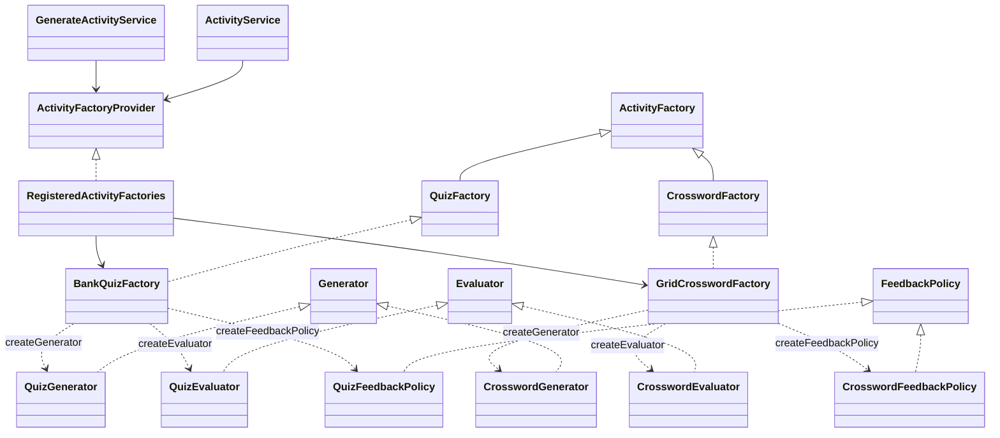

# H3: motor de actividades

H3 permite crear Quiz y Crucigrama en una materia propia, consultarlos, enviar respuestas y recuperar la evaluación persistida. Spring mantiene la autoridad sobre propiedad, claves y puntuación. El módulo usa Java 21/Spring Boot 4.1.2 y conserva las fronteras hexagonales. Los cambios se limitan al core, documentación y script de pruebas.

## Familias Abstract Factory



`ActivityFactory<A,S>` vincula actividad, generador, evaluador y respuesta de una familia mediante genéricos. `activityClass()` recupera el snapshot tipado y `submission()` adapta el mapa público a `QuizAnswers` o `CrosswordAnswers`. El servicio solicita los productos mediante `ActivityFactoryProvider` tanto al generar como al evaluar. Las proyecciones públicas distinguen los formatos de presentación; la selección de productos usa el registro de fábricas.

## Contenido y generación

El propietario aporta un `ActivityBank` con `validated:true`, una declaración de revisión previa del autor. Spring valida IDs únicos, opciones distintas, clave existente, límites, tema y palabras normalizadas. Esta declaración no certifica por sí sola la veracidad académica de un banco. Se necesita revisión editorial antes de distribuir material a otros alumnos; H3 permite únicamente trabajar con materias propias.

Quiz requiere de 2 a 6 opciones por pregunta, identificadas con IDs estables. El generador selecciona al azar `count` preguntas del tema exacto y mezcla sus opciones sin cambiar IDs ni claves. La explicación procede del banco. Si faltan preguntas, responde 422 `INSUFFICIENT_CONTENT`. No existe un banco predeterminado de producción.

Crucigrama selecciona `count` palabras del tema, ordenadas por longitud descendente e ID. Usa de 2 a 12 palabras, cada una de 2 a 25 letras. Normaliza a mayúsculas, elimina tildes, espacios y guiones y conserva Ñ como letra distinta: `cañón` pasa a `CAÑON`, `niño` a `NIÑO`; `ano` no equivale a `año`. Busca una cuadrícula conectada horizontal/vertical de tamaño máximo `gridSize` (5–25), impide superposiciones del mismo sentido, letras incompatibles y contactos laterales. Recorta el área ocupada y numera inicios en orden de fila/columna. Las coordenadas comienzan en cero; las celdas ausentes son bloques.

La búsqueda tiene un presupuesto de 50 000 pasos por generación. Un error 422 `INVALID_CROSSWORD` significa que no encontró una solución dentro del tamaño y presupuesto; no demuestra imposibilidad matemática. Cambiar palabras o ampliar la cuadrícula puede resolverlo. Todas las palabras seleccionadas deben colocarse; el generador no descarta silenciosamente una palabra elegida.

## Documentos READY y trazabilidad

Una actividad siempre pertenece a una materia. Si se indica `documentId`, Spring verifica propietario de materia y documento, pertenencia a esa materia, estado READY y texto extraído no vacío. Las entradas del banco requieren `source.reference`, `source.fragmentIndex` y `source.quote`. La cita debe aparecer literalmente en el fragmento indicado y contener la respuesta correcta tras la normalización común. Esto verifica evidencia textual; la relación semántica entre enunciado, opciones y cita sigue dependiendo de la revisión del autor.

Se puede aportar el banco junto con el documento. Si se omite `bank`, el texto completo extraído debe ser JSON con la estructura `ActivityBank`; el mismo mecanismo de citas se aplica después del parseo. Un documento narrativo o una extracción sin ese formato devuelve `INSUFFICIENT_CONTENT`; el usuario puede aportar un banco revisado con evidencia de sus fragmentos. No se interpreta prosa libre con reglas que inventen preguntas. Flask/OCR conservan su contrato y código.

El snapshot privado conserva los IDs, citas, claves y explicaciones originales. `documentId` enlaza al documento y cada entrada conserva su fragmento. El DTO público incluye referencia/índice de fuente, pero omite `quote`, claves y explicaciones, que podrían revelar la respuesta. Los bancos sin documento pueden tener una referencia externa opcional.

## API pública

Todas las rutas requieren Bearer SIARE, sesión vigente y propiedad de la materia. Usan el formato de errores existente `{timestamp,status,code,message,fields}` y `Cache-Control: no-store` en respuestas exitosas.

| Método | Ruta con prefijo `/api/v1` | Resultado |
| --- | --- | --- |
| POST | `/subjects/{subjectId}/activities` | 201 y Location de la actividad, sin solución |
| GET | `/subjects/{subjectId}/activities?limit=20&cursor=...` | 200, `{items,nextCursor}` |
| GET | `/activities/{activityId}` | 200, actividad sin solución |
| POST | `/activities/{activityId}/submissions` | 200, resultado durable, también en reintentos |
| GET | `/activities/{activityId}/submissions/{attemptId}` | 200, resultado propio con errores/aciertos |

El catálogo ordena por activityId ascendente. `limit` admite 1–100; `nextCursor` es el último UUID recibido o null. El cursor no concede acceso. La consulta de materia archivada y de resultados anteriores sigue permitida; generar y enviar un intento nuevo requiere materia activa. Repetir una clave ya confirmada devuelve su resultado incluso después del archivo.

Ejemplo de cuerpo para crear un Quiz de una pregunta, con datos educativos sintéticos revisados para pruebas:

```json
{
  "type": "QUIZ",
  "topic": "Repaso",
  "count": 1,
  "gridSize": 15,
  "bank": {
    "validated": true,
    "questions": [{
      "id": "q1", "prompt": "¿Cuánto es 2 + 2?", "topic": "Repaso",
      "options": [{"id":"a","text":"4"},{"id":"b","text":"5"}],
      "correctOptionId": "a", "explanation": "2 + 2 = 4."
    }],
    "words": []
  }
}
```

`gridSize` es obligatorio también en Quiz, donde no se utiliza. Para generar un crucigrama:

```json
{
  "type":"CROSSWORD", "topic":"Astronomía", "count":2, "gridSize":15,
  "bank":{
    "validated":true, "questions":[],
    "words":[
      {"id":"w1","answer":"SOL","clue":"Estrella del sistema solar.","topic":"Astronomía"},
      {"id":"w2","answer":"LUNA","clue":"Satélite natural de la Tierra.","topic":"Astronomía"}
    ]
  }
}
```

El cliente envía un mapa questionId/optionId para Quiz o wordId/texto para Crucigrama. Puede omitir respuestas; las omisiones cuentan como error. IDs desconocidos u opciones ajenas producen 400. Cada palabra o pregunta pesa lo mismo. `score = points/total`, en 0–1; `percentage = score*100`.

```json
{
  "idempotencyKey":"00000000-0000-4000-8000-000000000001",
  "answers":{"q1":"a","q2":"b"},
  "durationMs":45000
}
```

El resultado incluye `items` con ID, acierto, respuesta enviada, solución esperada, explicación y feedback producido por la política de su familia. El alumno puede identificar los errores después de enviar. La consulta de actividad conserva el DTO sin soluciones después de responder; las soluciones se consultan únicamente en el resultado autorizado.

Las respuestas completas [Quiz creado](examples/h3/quiz.json), [Crucigrama creado](examples/h3/crossword.json) y [resultado del intento](examples/h3/result.json) se capturaron de la API MockMvc real con MySQL aislado. Los UUID corresponden a fixtures temporales, no a recursos de la instancia. La prueba usa pistas sintéticas para verificar el formato. [OpenAPI](openapi.json) describe todos los campos y rangos.

## MySQL e idempotencia

Flyway V5 añade tres tablas sin modificar V1–V4 ni borrar datos. `academic_activities` almacena materia, familia, documento opcional, tema, fecha, estado AVAILABLE, contenido público y `answer_key_json`. Esta última columna contiene el snapshot completo privado e inmutable, incluidas las claves de evaluación; el contenido público se guarda por separado. JPA valida el esquema al arrancar.

`academic_attempts` guarda identidad verificada, clave idempotente, huella SHA-256, IDs de intento/evento, score, duración, fecha y resultado con feedback. `UNIQUE(activity_id,student_id,idempotency_key)` impide duplicados. Se ordena el mapa de respuestas para calcular la huella junto con la duración. Mismo cuerpo y clave devuelve exactamente el mismo resultado; cambiar respuestas o duración produce 409 `IDEMPOTENCY_CONFLICT`. Una nueva clave representa otro intento.

El servicio bloquea la fila de actividad antes de consultar/insertar el intento. JDBC y JPA comparten la transacción: evaluación e inserción en outbox confirman juntas; un fallo hace rollback de ambas. Los índices permiten catálogo por materia y consulta de intentos/eventos; FKs conservan usuarios, materias y actividades. Los documentos viven en MongoDB: `document_id` es una referencia lógica autorizada, sin FK entre motores.

La protección de la clave se aplica en los DTO y autorización del servidor. El snapshot no lleva cifrado adicional en esta entrega y requiere la misma protección de acceso y respaldos que el resto de MySQL. Los controladores no serializan entidades JPA. Spring rechaza campos de cliente desconocidos, como studentId, score, attemptId o eventId; los cuerpos de creación y envío se redactan en `toString()`.

## Evento para Express

El evento persistido usa los nombres de la propuesta del [PR #4](https://github.com/SttivGG/siare-academico/pull/4), que sigue separado de esta rama. La implementación del productor no acredita acuerdo del consumidor. Se debe revisar con el responsable de Express antes de instalar el transporte HTTP.

```json
{
  "schemaVersion":1,
  "eventId":"50e7db1d-adb6-411f-8e9a-652abe062f4c",
  "attemptId":"28466693-ceb3-4a86-ab38-3b14129b5e4c",
  "studentId":"4c881032-3bd4-49b6-8584-adb854fb0a9b",
  "subjectId":"678e45e5-10d2-4c9d-b13b-923418257748",
  "activityId":"fe4718b4-5eb5-422e-a801-2066563ff81c",
  "activityType":"QUIZ", "eventType":"ATTEMPT_EVALUATED",
  "score":0.5, "durationMs":45000,
  "occurredAt":"2026-11-18T23:11:28.610926500Z", "source":"core-api"
}
```

Spring obtiene studentId de la identidad autenticada, genera attemptId/eventId/occurredAt y calcula score. `durationMs` admite 0–86 400 000 y es una medición declarada por el cliente, no una duración certificada. El evento omite preguntas, respuestas, citas, nombres y correos.

`AttemptEventPublisher` define el puerto de salida. Al confirmar una evaluación, el evento queda PENDING en `academic_attempt_outbox`. `JdbcAttemptOutbox` reserva eventos mediante un token y lease de 120 s; las actualizaciones condicionales impiden que un worker antiguo revoque el progreso de otro. `AttemptOutboxDispatcher` usa esperas crecientes de hasta una hora y conserva eventId en reintentos. Una caída tras publicar y antes de confirmar puede repetir un evento: la entrega es al menos una vez, y Express debe deduplicarlo durablemente.

El scheduler comprueba cada diez segundos si existe un adaptador de `AttemptEventPublisher`. Esta entrega no instala transporte: los eventos permanecen durables PENDING y el alumno recibe su resultado sin esperar a Express. El adaptador futuro deberá enviar `POST /internal/v1/attempts`, `Idempotency-Key: eventId`, `X-Request-Id`, versión y credencial propia de servicio, y aceptar éxito solo después del acuse durable. No debe confirmar un evento ante timeout, 409 inesperado o una respuesta inválida. Credenciales, política de conflictos y aceptación del consumidor quedan pendientes.

Python recibirá posteriormente observaciones autorizadas para recomendaciones. H3 no implementa ML, tablas Cassandra, ingesta ClickHouse, indicadores ni consultas de progreso.

## Web pendiente y validación

El siguiente trabajo web requiere rutas BFF autorizadas con cookies/CSRF, catálogo de actividades, editor/importación de banco, presentación de preguntas/celdas, envío con clave persistida durante reintentos y revisión de resultados. El frontend no debe calcular ni enviar una puntuación autoritativa. React Native y los módulos Express/Python quedan fuera de este PR.

Los comandos, resultados y límites de prueba están en [H3_VALIDACION.md](H3_VALIDACION.md). Para las decisiones de transacción se consultaron [TransactionTemplate de Spring](https://docs.spring.io/spring-framework/reference/data-access/transaction/programmatic.html) y [bloqueos InnoDB MySQL 8.4](https://dev.mysql.com/doc/refman/8.4/en/innodb-locking-reads.html).
