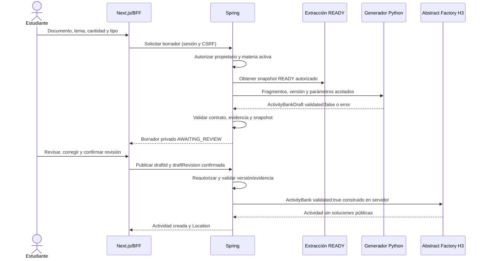

# H5-A: generación de actividades desde documentos

Fecha de corte: 19/11/2026, America/Bogota. Estado: diseño de integración y contrato
v1 propuesto; pendiente de conformidad del responsable ML. Esta entrega prepara
documentación, esquemas y pruebas sintéticas. No instala endpoints ni genera
actividades automáticamente en la aplicación actual.

## 1. Diagnóstico y dependencias

| Referencia comprobada | Estado al corte | Consecuencia para H5 |
| --- | --- | --- |
| [PR #6](https://github.com/SttivGG/siare-academico/pull/6), `acba2808ad0908ff05d6852cedb6eba5cb281171` | Abierto, no fusionado, fusionable individualmente contra main | Conservar cuarentena, C2PA sin verificar, integridad, OCR y aislamiento Linux |
| [PR #7](https://github.com/SttivGG/siare-academico/pull/7), `1e8658ed555c952991bff85c9bb2b5dd8ee4a5e1` | Abierto, no fusionado, fusionable individualmente contra main | Conservar H4, allowlist BFF, CSRF, límites y tres paneles |
| main / base de ambos PR | `6c3a742abd7c344c1810af699ba4ff10d0678c35` | H3 ya está integrado; los dos PR todavía no |
| Integración local de H4 + documentos | `697621ee8a6a450c551bbf6f13ffda6fc2beab18`, rama `integration/h4-documents-deploy-20261119` | Base técnica conjunta disponible en `.worktrees/h4-integrated`; no equivale a main consolidado |
| Checkout de esta entrega | `fix/document-compatibility-isolation`, `acba2808ad0908ff05d6852cedb6eba5cb281171` | Contiene cambios locales ajenos; no usarlo para reconstruir el frontend H4 |

GitHub devolvió cero revisiones, cero estados de commit y cero ejecuciones de
workflows de PR para esos HEAD. Eso no acredita CI aprobado. Las comprobaciones
locales históricas están en los informes respectivos; esta tarea no las repite.

Los PR comparten `frontend/src/components/subject-documents.tsx` y
`frontend/tests/e2e/phase-two.spec.ts`. La integración local registra un conflicto
en el componente y una integración automática de las pruebas. Conservó selección
READY, descarga exclusiva para READY, advertencias C2PA/OCR y texto escapado junto
al diseño H4. El detalle está en [el informe local H4](H4_DESPLIEGUE_20261119.md).
Ese informe es evidencia local preexistente y todavía no está en main.

Orden seguro propuesto: revisar y autorizar #6 primero; integrar #7 sobre esa base
con la resolución conjunta ya ensayada; repetir las regresiones documentales/H3/H4
y revisar el diff completo antes de autorizar su fusión. La condición de
fusionable contra main no asegura compatibilidad entre ambos. No se fusionó ni
se publicó ningún PR en esta tarea. Se puede preparar H5 desde el commit local
integrado con trazabilidad; no declarar una base pública consolidada hasta cerrar
las integraciones autorizadas.

### Documentos revisados y desfases

| Fuente | Revisión consultada | Hallazgo |
| --- | --- | --- |
| [H3_ACTIVIDADES.md](H3_ACTIVIDADES.md) y [OpenAPI vigente](openapi.json) | Checkout `acba280` | API H3 real, banco validado, citas y Abstract Factory; no hay generador de prosa |
| [H4_CONTRATO_GENERACION_ML.md](https://github.com/SttivGG/siare-academico/blob/1e8658ed555c952991bff85c9bb2b5dd8ee4a5e1/docs/H4_CONTRATO_GENERACION_ML.md) | HEAD #7 | Propuesta sin acuerdo; menciona ActivityBank con false, incompatible con su constructor actual |
| [CONTRATOS_EQUIPO.md](https://github.com/SttivGG/siare-academico/blob/da02404200edb54bf1584f78c3253814c6544a9e/docs/CONTRATOS_EQUIPO.md) | Rama `docs/organizacion-equipo-contratos`, `da02404200edb54bf1584f78c3253814c6544a9e` | Convenciones y responsabilidades; corte anterior a H3, sus afirmaciones de ausencia de actividades ya están desactualizadas |
| [ONBOARDING_AI.md](https://github.com/SttivGG/siare-academico/blob/da02404200edb54bf1584f78c3253814c6544a9e/docs/ONBOARDING_AI.md) | Misma rama documental | ML pertenece al integrante 3; extracción y entrenamiento deben seguir separados |

Los tres últimos documentos no existen en este checkout. Se consultaron desde
sus ramas, sin copiarlos sobre la base ni modificar responsabilidades. El contrato
de recomendaciones de aprendizaje es distinto de generar bancos desde documentos.
Sus plazos de 10 s y límite genérico de 1 MiB no son el SLA de generación H5.

### Base ejecutada, comprobada en solo lectura

Proyecto Compose activo: `siare-academico`. Usa `compose.datos.yml`,
`compose.apps.yml` y el override privado congelado
`.local/deployment-h4-20261119/frontend-source.json` para frontend. Los nueve
servicios estaban healthy y `http://127.0.0.1:3100/api/health` devolvió 200/UP.

| Servicio | Contenedor | Imagen activa SHA-256 |
| --- | --- | --- |
| frontend | `eae9ae80e3c1` | `c67d08bd4d4ef8e405f1d886ed3fec4c9fdb62f06be117184a8ff68c7c9ff5b0` |
| core-api | `27138d454210` | `ecff70dea3a1061462ec103d81fed5f6729a2b8cee1113670afc87f814642e84` |
| content-ai | `8a7f97dc46a9` | `212a8df4b6896d98ad607d66db4c7f03d562fa871dffa8f8e9bae93d17f36ba4` |

Frontend declara revisión OCI `697621e`; Spring/Python no declaran revisión OCI.
El informe H4 relaciona sus imágenes con #6, pero esa relación no se deduce de
sus etiquetas. No se reconstruyó, recreó ni reinició ningún servicio para esta
entrega de contratos. La imagen de reversión H4 figura en su informe previo;
su comprobación se debe repetir antes del próximo despliegue funcional.

## 2. Arquitectura elegida

Spring conserva autorización, creación, claves, evaluación e idempotencia de
intentos. Python solo propone contenido; no persiste actividades, asigna notas,
accede a GridFS o decide permisos. Next.js usa el BFF existente y nunca llama
directamente al endpoint interno. La experiencia futura permitirá seleccionar y
revisar contenido mediante controles de formulario; escribir o importar JSON será
opcional. Esta fase no cambia controles visuales ni el diseño de los tres paneles.

### Puertos existentes y adiciones previstas

`ActivityUseCase` / `ActivityService` ya autorizan y crean actividades;
`GetDocumentUseCase` / `DocumentRepository` proporcionan metadatos y texto;
`StructuredActivityContent` / `JsonStructuredActivityContent` interpretan JSON
revisado, no prosa. `GenerateActivityUseCase` / `GenerateActivityService` llaman a
`ActivityFactoryProvider`; `BankQuizFactory` y `GridCrosswordFactory` producen los
generadores, evaluadores y políticas de feedback H3. `DocumentProcessor` y
`HttpDocumentProcessor` quedan dedicados a extracción.

Proponer puertos de entrada `RequestActivityDraftUseCase`, `ReadActivityDraftUseCase`,
`ReviseActivityDraftUseCase` y `PublishActivityDraftUseCase`; puertos de salida
`ActivityDraftGenerator`, `ActivityDraftRepository` y `DocumentExtractionSnapshot`.
El adaptador `HttpActivityDraftGenerator` usará un cliente HTTP separado del de
extracción. Los DTO de transporte y `ActivityBankDraft` no dependerán de
`ActivityBank` ni se deserializarán a él: su constructor rechaza `validated:false`.

El nuevo publicador compartirá el camino de creación H3. Se extraerá una operación
interna común que permita insertar actividad y marcar borrador publicado en una
misma transacción MySQL; no se hará una llamada HTTP de Spring a su propio POST.
Se preservan las firmas públicas H3 y sus consumidores manuales.

### Snapshot, revisión y publicación

La versión propuesta es `operation:<UUID>` de la operación READY persistida.
Ya existe `operationId` público en metadatos y Mongo separa fragmentos por
`(documentId, operationId, index)`. Falta ofrecer un snapshot autorizado coherente
que reúna versión, fragmentos y advertencias. La lectura nueva comprobará
metadatos antes y después y exigirá el mismo operationId y estado READY. No basta
el checksum del binario: la extracción puede cambiar sin cambiar el PDF.

Hoy `DocumentService.process` devuelve READY sin reprocesarlo y `claim` no reserva
READY. Por tanto esa operación es inmutable en la API actual. H5 mantendrá esa
regla y no agregará reprocesamiento. Si posteriormente se permite sustituir una
extracción READY, será necesaria coordinación de publicación/invalidez entre
Mongo y MySQL; una segunda lectura por sí sola no elimina una carrera entre bases.
Esa capacidad queda fuera de v1 y bloquea su activación hasta acordar exclusión.

Spring guarda el borrador privado, ownerId derivado de sesión, parámetros,
snapshot de los fragmentos usados, versión de generador, resultado de validación,
`draftRevision` creciente y expiración de 24 h. Estado inicial AWAITING_REVIEW;
publicación produce PUBLISHED y fija activityId. La expiración impide nueva
publicación, pero no borra documentos ni actividades. Se propone una migración
Flyway aditiva con el siguiente número disponible para borradores y unicidad;
no se reescriben migraciones históricas. La política de retención física de
borradores privados se acordará antes de activar persistencia en producción.

Cada edición usa revisión esperada y devuelve la siguiente. Spring reinicia la
confirmación tras cualquier edición; el publicador requiere `reviewConfirmed:true`
y la revisión vigente. El servidor verifica propietario, materia activa, TTL,
estado, versión, evidencia y calidad estructural antes de construir ActivityBank.
`validated:true` representa la declaración del estudiante autenticado, no una
certificación académica automática. Se registra quién confirmó, cuándo y qué
revisión; el contenido editado y las justificaciones quedan en el snapshot privado.
Las declaraciones originales de calidad ML identifican la revisión 1; una edición
posterior no hereda automáticamente su valoración semántica.

Bloquear borrador en MySQL durante publicación; actividad, revisión confirmada y
resultado idempotente se confirman juntos. Un borrador produce como máximo una
actividad. Reintento de la misma clave/cuerpo devuelve la misma actividad; cambio
de revisión con esa clave: 409. Tras publicación, cualquier clave nueva devuelve
409 DRAFT_ALREADY_PUBLISHED. Recuperar un resultado ya confirmado vuelve a
autorizar su lectura y conserva la semántica H3 para materias archivadas.

El alumno que revisa ve respuestas y explicaciones. H5 es práctica personal, igual
que H3; no acredita un examen ciego. Las proyecciones para resolver y el catálogo
siguen omitiendo claves, citas y explicaciones hasta el resultado autorizado.

## 3. Contrato y acuerdo ML

La especificación normativa propuesta está en [H5_CONTRATO_GENERACION_ML.md](H5_CONTRATO_GENERACION_ML.md).
Incluye JSON Schema, OpenAPI independiente y ejemplos válidos de ambas familias.
Resuelve los nombres y límites desde el lado consumidor; su activación sigue
pendiente de acuerdo del productor. El usuario confirmó el 19/11/2026 que todavía
no hay respuesta ni propuesta del responsable ML. Por tanto, los nombres,
presupuestos y criterios aquí descritos son propuestas del consumidor pendientes
de revisión conjunta; no se enviaron mensajes externos en su nombre.

El acuerdo deberá registrar responsable, fecha, versión del contrato, commit de
fixtures, política de datos, modelo/plantilla y evidencia de pruebas del productor.
Generación será opt-in y permanecerá deshabilitada sin adaptador y capacidad ML
confirmados; H3 manual y extracción deben seguir disponibles si ML falla.

## 4. Cambios por responsable

| Responsable | Trabajo posterior | Frontera que conserva |
| --- | --- | --- |
| Nuestro equipo, Spring | Snapshot coherente; DTO draft; casos de uso; validación de evidencia; adaptador HTTP; persistencia/revisiones/TTL; publicación atómica H3; cuotas y redacción de logs | Permisos y evaluación en Spring; extracción y fábricas existentes |
| Integrante ML, Python | Endpoint interno; generación de Quiz/pistas; selección de evidencia; rechazo de ambigüedad/OCR ilegible; métricas y dataset; presupuestos, cancelación y versión de modelo | Extracción, sandbox, cuarentena, contrato existente y datos privados |
| Nuestro equipo, Next.js | Tipos y allowlist pública H5; formularios de generación/revisión; confirmación vinculada a revisión; manejo de errores y reintentos | Cookies HttpOnly, CSRF, renovación, tres paneles y visual H4 |
| Líder + ML | Aprovisionamiento de credencial de generación, política de datos, recursos y despliegue selectivo | .env actual, token de extracción, secretos MFA/JWT/OIDC y red interna |

No se modifica `services/content-ai/` en esta entrega. El compañero elegirá el
modelo y evaluará calidad; el equipo Spring no simulará un generador de producción
con plantillas que inventen contenido. Móvil, Express y analítica quedan fuera.

## 5. Implementación por subfases

| Subfase | Resultado revisable | Puerta de aceptación |
| --- | --- | --- |
| H5-A0, esta entrega | Diagnóstico, contratos y fixtures independientes | Suite local de contrato y revisión del diseño; acuerdo ML aún pendiente |
| H5-A1, base y acuerdo | Integración autorizada #6/#7, contrato aceptado, credencial/presupuestos y política de datos acordados | Regresiones conjuntas y acta productor/consumidor |
| H5-A2, Spring aislado | DTO/puertos, snapshot, repositorio, validador y simulador solo de pruebas | Tests de autorización, versiones, concurrencia, publicación y regresión H3 |
| H5-A3, ML en su rama | Productor Python contra fixtures y evaluación semántica | Contrato productor, corpus acordado, métricas y carga sin degradar extracción |
| H5-A4, transporte | Adaptador Spring opt-in con errores acotados | HTTP real, autenticación, límites, timeouts y datos mínimos |
| H5-A5, flujo web posterior | Generar, revisar y confirmar sin escribir JSON | Navegador sobre tres paneles existentes; sin rediseño |
| H5-A6, despliegue | Instalación habitual con las capacidades aceptadas | Salud, flujo real, preservación y reversión documentados |

Las pruebas de puertos y productor pueden avanzar con fixtures antes de tener
transporte. Esta entrega no implementa A2–A6 ni atribuye al generador resultados
de una evaluación académica aún inexistente.

## 6. Pruebas y aceptación

La suite [contracts/h5](contracts/h5/README.md) comprueba esquemas y reglas cruzadas
con contenido sintético. Cada equipo reutilizará las mismas fixtures desde sus
tests de consumidor/productor. Pasar estos tests no prueba HTTP, persistencia,
calidad de lenguaje natural ni integración con el stack real.
El registro de ejecución y salud de esta entrega está en [H5_VALIDACION.md](H5_VALIDACION.md).

| Nivel posterior | Casos obligatorios | Criterio |
| --- | --- | --- |
| Spring/autorización | Sesión inválida, MFA pendiente, usuario ajeno, materia archivada, documento de otra materia, cuarentena | Rechazo previo a llamar a ML; ninguna actividad ni fragmento ajeno expuesto |
| Snapshot | Operación cambiada entre lecturas, extracción ausente, contenido vacío, cita de otra versión | 409/422/503 según contrato; ninguna publicación obsoleta |
| Consumidor/productor HTTP | Dos familias, headers, versión, JSON roto, campos extra, clave/cita errónea, respuesta demasiado grande, 401/429/503, timeout y cancelación | Spring valida aun ante productor incorrecto y redacta errores |
| Revisión y persistencia | Sin confirmar, false, revisión vieja, cambios posteriores, expiración, concurrencia, caída al insertar | Cero actividades sin revisión; rollback completo y máximo una actividad por draft |
| H3 | Banco convertido, límites, Ñ, puntuación, catálogo/resultado, reintento | Misma semántica y respuestas públicas sin soluciones |
| Crucigrama | Palabras válidas sin cuadrícula conectada | H3 puede devolver INVALID_CROSSWORD; borrador revisable conservado, sin actividad parcial |
| Calidad ML | Tema ausente, insuficiencia, OCR roto, premisas falsas, dos opciones válidas, duplicados, instrucciones maliciosas en texto | Rechazar o pedir menos contenido; ninguna pregunta de relleno |
| Web futura | Documento READY, formularios, revisión, confirmación, fallo/reintento y éxito | Quiz y crucigrama completos sin escribir JSON; llamadas solo al BFF |
| Regresión | C2PA, OCR, cuarentena, descarga exacta, H3/H4, sesiones, MFA y OIDC | Contratos, seguridad y datos conservados |

ML acordará un corpus sintético y un conjunto autorizado separado, con revisión
humana por ítem de respuesta única, evidencia, explicación y distractores. Antes
de habilitarlo, todas las salidas aceptadas en el corpus deben pasar estructura y
evidencia, y el conjunto adversarial no debe producir bancos de relleno. El
umbral de aceptación semántica, tamaño del corpus y revisores siguen pendientes;
no se deducen métricas de calidad de estas fixtures. Registrar cobertura/rechazos,
p50/p95, CPU, memoria y fallos con hardware y versiones.

## 7. Riesgos y cierre operativo

Las dependencias de activación son la consolidación pública autorizada, conformidad
ML, recursos de inferencia dentro del servicio de 256 MiB/0,5 CPU, cancelación
efectiva, credencial independiente, retención y criterios académicos. Una cita que
contiene la respuesta no demuestra que la pregunta tenga una sola interpretación;
las comprobaciones de Spring complementan la revisión humana y la evaluación ML.
El indicador OCR_APPLIED no proporciona confianza OCR por fragmento.

Cada subfase funcional deberá usar los controles de `scripts/Common.ps1`, verificar
el proyecto e imágenes realmente activos y conservar una imagen funcional para
reversión. Construir desde una fuente congelada revisada de la integración H4,
no desde este checkout anterior a H4 ni desde el override antiguo. Recrear solo
los servicios cambiados con los dos Compose oficiales, `--no-deps` cuando proceda,
`--no-build --pull never --wait` tras el build selectivo. Coordinar Python con ML.

Registrar rama, commit, imágenes, contenedores y pruebas. Esperar healthy y validar
en `http://127.0.0.1:3100`, con navegador si cambia la interfaz. No usar `down -v`,
prune, reinicialización de datos, cambios de redes o secretos para resolver fallos.
Esta entrega solo añade contratos, documentación y su verificador de pruebas;
no afecta código de contenedores ni requiere despliegue.
