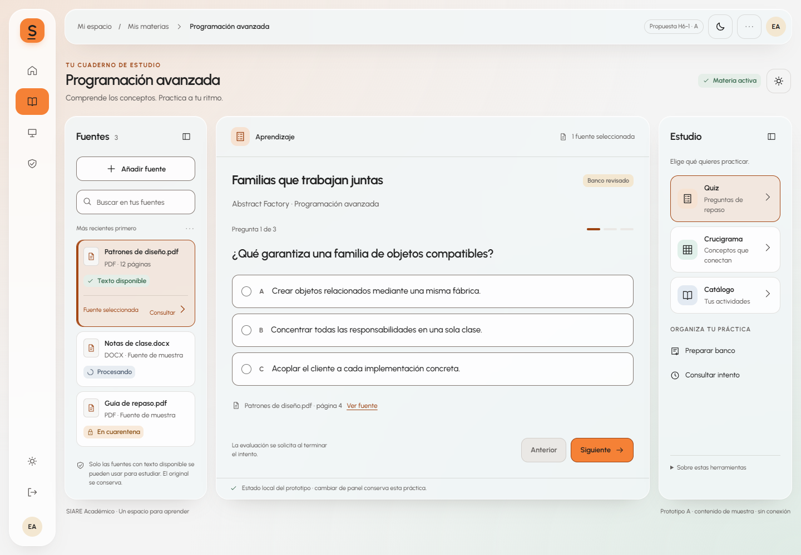
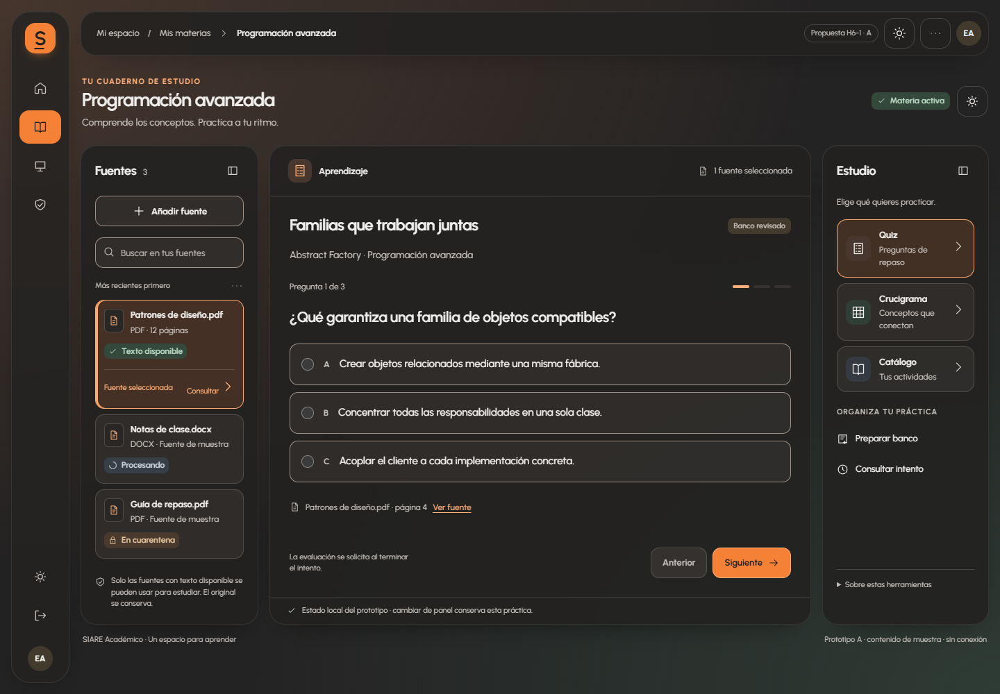
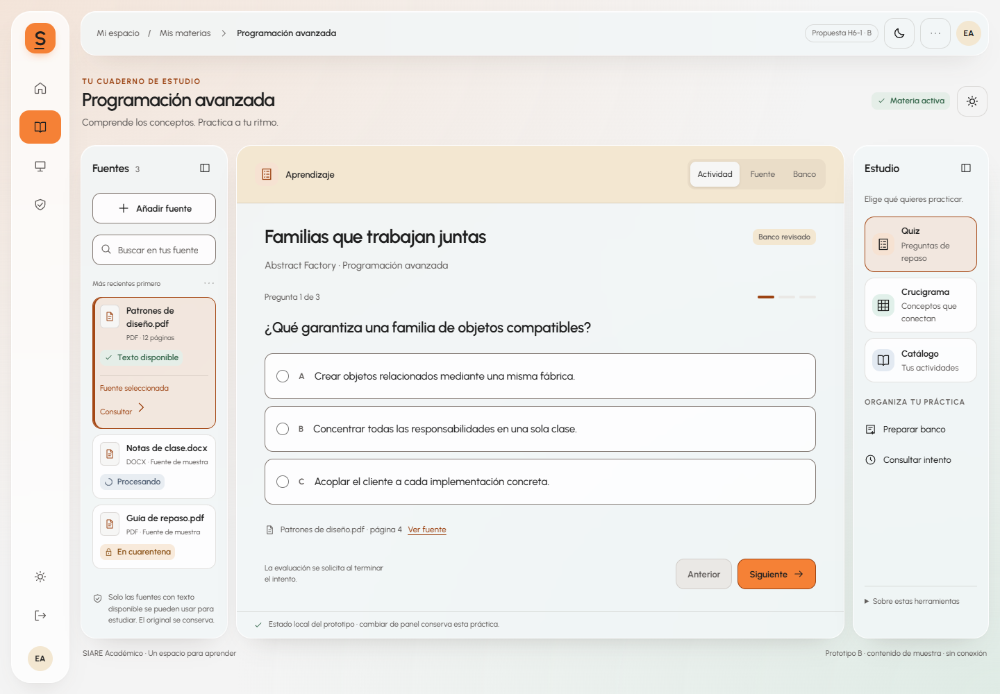
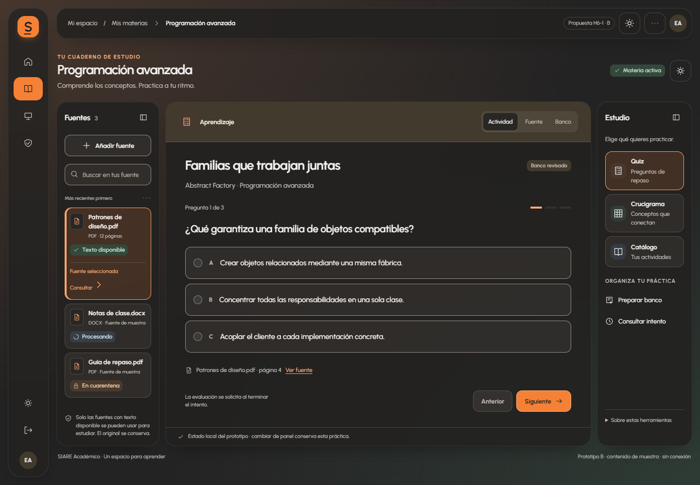

# H6-1: dos alternativas de workspace

Ambas usan el mismo Design System Nexo y las herramientas H3/H4. Los anchos se midieron en Chromium sobre prototipos locales; no son una implementación del shell H6-2 ni una aprobación de la distribución H6-3.

## A: Cuaderno abierto, recomendada

En escritorio, las fuentes y herramientas permanecen visibles mientras el estudiante resuelve una actividad en el centro. Se reconoce la organización de NotebookLM sin imitar sus funciones de chat o Studio. La carga de archivos se abre bajo demanda. El formulario de materia deja de ocupar el centro y pasa a opciones de materia.

| Espacio a 1440 px | Dimensión |
| --- | --- |
| Barra / separación / margen exterior | 84 / 16 / 16 px |
| Área de workspace | 1308 px |
| Fuentes | 256 px |
| Aprendizaje | 780 px, 59,6 % del workspace |
| Estudio | 240 px |
| Separaciones entre paneles | 16 px cada una |

Aprendizaje es más ancho que ambos laterales sumados. La lectura, el Quiz, el Crucigrama, el banco y la consulta de intentos se abren aquí. El texto de fuente se consulta sin abandonar la actividad de forma destructiva. Los datos reales de puntuación aparecen solo al consultar o recibir una evaluación.

En tableta se muestran Fuentes y Aprendizaje: 224 y 684 px a 1024 px de viewport. El botón Estudio abre herramientas a la derecha y oculta Fuentes, manteniendo el centro. En móvil se presenta un panel por vez y una navegación inferior de Fuentes, Aprendizaje y Estudio con nombres visibles. Aprendizaje abre primero, aproximadamente en y=184 px a 390 px de ancho, frente a y≈1311 de la muestra H6-0.

Ventaja: fuentes y opciones de práctica se descubren sin cambiar de contexto en escritorio. La navegación inferior queda cerca del pulgar en móvil. Coste: más elementos simultáneos y una barra móvil que debe convivir con teclado virtual, safe area y foco; esas condiciones requieren pruebas antes de desplegar.

## B: Estudio en enfoque

Los laterales son más compactos. Una banda crema suave delimita las vistas de Actividad, Fuente y Banco dentro del centro. El estudiante puede trabajar con más ancho y menos texto auxiliar. Las funciones de catálogo e intentos siguen accesibles desde Estudio.

| Espacio a 1440 px | Dimensión |
| --- | --- |
| Área de workspace | 1308 px |
| Fuentes | 212 px |
| Aprendizaje | 876 px, 67 % del workspace |
| Estudio | 196 px |
| Separaciones entre paneles | 12 px cada una |

En tableta, Aprendizaje ocupa inicialmente los 924 px disponibles. Fuentes o Estudio se muestran bajo demanda junto al centro, con 224 px, sin perder el borrador ni el intento. En móvil el selector de panel ocupa la parte superior del workspace y no hay una barra inferior fija. Aprendizaje empieza aproximadamente en y=254 px en la muestra de 390 px.

Ventaja: mayor espacio para lectura, banco o crucigramas; tableta empieza centrada en una sola tarea. Coste: nombres largos de fuentes envuelven antes y las herramientas quedan menos expuestas. En móvil, el selector superior se aleja al desplazarse por un documento largo; requiere una decisión de retorno accesible en H6-3.

## Comparación para elegir

| Criterio | A: Cuaderno abierto | B: Estudio en enfoque |
| --- | --- | --- |
| Relación con NotebookLM | Tres áreas visibles y fáciles de descubrir | Mismas áreas, compactas, con más ancho para la tarea |
| Centro a 1440 px | 780 px | 876 px |
| Muestra inicial de tableta | Fuentes + tarea | Solo tarea; lateral bajo demanda |
| Móvil | Navegación inferior fija y tres paneles excluyentes | Selector superior y tres paneles excluyentes |
| Material largo / edición avanzada | Adecuado; se debe limitar ancho de lectura | Más margen para bancos y rejillas |
| Descubrimiento de herramientas | Mayor | Requiere más cambios de vista en tableta |
| Riesgo principal | Barra inferior, teclado y foco | Laterales estrechos y retorno al selector superior |
| Conservación de estado requerida | La misma, bloqueante | La misma, bloqueante |

Recomiendo A como punto de partida por la visibilidad de fuentes/herramientas y su cercanía a la estructura elegida. B es una alternativa válida si se prioriza lectura o edición avanzada sobre descubrimiento. La elección no debe dividir ni duplicar la lógica de actividades; el estado académico debe ser independiente del layout.

## Comportamiento responsive propuesto

| Ancho CSS | A | B | Regla común |
| --- | --- | --- | --- |
| 1700 px o más | Fuentes 280; Estudio 264; centro flexible | Fuentes 240; Estudio 224; centro flexible | Márgenes/rail Nexo y centro con lectura de ancho controlado |
| 1200–1699 px | 256 / centro / 240, gap 16 | 212 / centro / 196, gap 12 | Tres paneles; contenido largo envuelve; sin mínimos que fuercen overflow |
| 701–1199 px | Dos paneles; herramientas alternan lateral | Centro inicial; un lateral opcional | Rail 64; prioridad de tarea; mismas respuestas y borrador al redimensionar |
| 320–700 px | Un panel, navegación inferior | Un panel, selector superior | Sin rail escritorio; botones con nombres; no duplicar ni desmontar la sesión académica |

Los breakpoints se basan en espacio útil de esta maqueta. H6-3 deberá validar especialmente el entorno de 1200 px, nombres de materia largos, 200 % real y cuadrículas grandes antes de consolidarlos. Cuando el centro no pueda mantener una tarea legible, se plegará un lateral en lugar de reducir letra o introducir scroll horizontal del documento.

Las fuentes conservan selección única: H3/H4 asocia una actividad a un documento opcional. La referencia visual no autoriza generación multidocumento ni selección múltiple de fuentes. Los cambios de panel son de presentación y no alteran respuestas, banco, referencia documental, duración o envío pendiente.

## Recorridos para revisar en la maqueta

1. Abrir [A clara](h6-1/prototipo.html?layout=a&theme=light) o [B oscura](h6-1/prototipo.html?layout=b&theme=dark). Cambiar tema y elegir una respuesta.
2. Abrir Preparar banco, escribir un tema, volver al Quiz y comprobar la respuesta. Regresar al banco y verificar su texto.
3. En móvil usar Fuentes, Aprendizaje y Estudio. Cambiar de herramienta dentro de Estudio; su contenido pasa al centro. La maqueta no hace peticiones a SIARE.
4. Abrir Añadir fuente y cancelar. Explorar el [catálogo de componentes](h6-1/prototipo.html?screen=system&theme=light), los estados y el diálogo de archivo.

La conservación de esta maqueta vive en el DOM local. No prueba el arreglo de React ni la recuperación tras recarga, fallo del navegador o caducidad. Esas condiciones están en [riesgos y regresiones](H6_1_RIESGOS_Y_REGRESIONES.md).

La decisión solicitada es elegir A/B, tema y densidad, o indicar ajustes concretos. La revisión de H6-1 precede a autorizar H6-2; H6-3 mantiene su aprobación expresa de distribución. No se acepta una elección por silencio ni se fusiona ningún PR.
