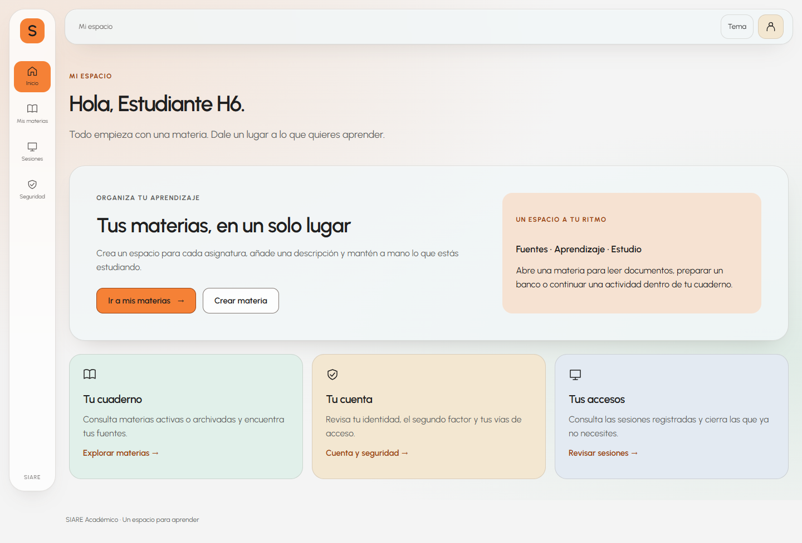

# H6-4 frente al Nexo original

La comparación usa las capturas originales preservadas en H6-0 y el frontend H6-4 realmente desplegado en 3107. Las capturas administrativas se identifican como fixtures controladas; no pertenecen a una sesión privilegiada de Spring.

| Rasgo | Nexo original | SIARE H6-4 |
| --- | --- | --- |
| Tipografía | Urbanist local | Misma fuente; cuerpo académico 16 px en lugar de 14 px |
| Acento | Naranja #F58136 con tinta oscura | Mismo acento en acciones y selección; enlaces/foco con los tokens legibles aprobados |
| Pasteles | Menta, rosa cálido, crema y azul | Paneles de Inicio, nota del cuaderno, tarjetas y estados; sin indicadores ficticios |
| Superficies | Glass, bordes suaves, radios 22–28 px | Shell y superficies compartidas; campos/listas con fondo más opaco para lectura |
| Navegación | Rail flotante de 84 px y cabecera | Se conserva en escritorio; menú con etiquetas en móvil y controles de tema/cuenta |
| Contenido principal | Gestión comercial y métricas de negocio | Accesos académicos y estados reales; no se copian fotografías, ventas ni porcentajes |
| Workspace | No tiene el dominio académico SIARE | Se conserva A: Fuentes, Aprendizaje y Estudio, con el jugador central único |

| Revisión | Original | H6-4 |
| --- | --- | --- |
| Escritorio claro | [Nexo](evidencias/h6-0/nexo-claro-original.png) | [Inicio real](evidencias/h6-4/rutas/R08-light-1440x900.png) |
| Escritorio oscuro | [Nexo](evidencias/h6-0/nexo-oscuro-original.png) | [Inicio real](evidencias/h6-4/rutas/R08-dark-1440x900.png) |
| Formulario | [Nexo](evidencias/h6-0/nexo-formulario-original.png) | [Creación de materia real](evidencias/h6-4/rutas/R10-light-1440x900.png) |
| Móvil | [Nexo](evidencias/h6-0/nexo-movil-original.png) | [Inicio real](evidencias/h6-4/rutas/R08-light-390x844.png) |
| Seguridad | Referencia de controles/paleta anteriores | [Identidad y MFA controlados](evidencias/h6-4/controlado/seguridad-activa-light-390x844.png) |
| Administración | Referencia de paneles/listas anteriores | [SUPERADMIN controlado](evidencias/h6-4/controlado/superadmin-dark-1440x900.png) |

La revisión visual comprobó jerarquía, continuidad de superficies, espaciado y adaptación. Corrigió el resumen de identidad móvil para evitar que el botón redujera el nombre a una columna de letras. Los controles de administración conservan la densidad de un formulario operativo; no trasladan la composición promocional de la portada a listas de usuarios.

El catálogo de [evidencia por caso](evidencias/h6-4/README.md) permite comparar claro/oscuro y los estados internos. La matriz distingue imágenes de ruta, pruebas reales, respuestas controladas y verificaciones pendientes. Esta comparación no acredita login externo, permisos privilegiados reales ni una auditoría WCAG completa.
