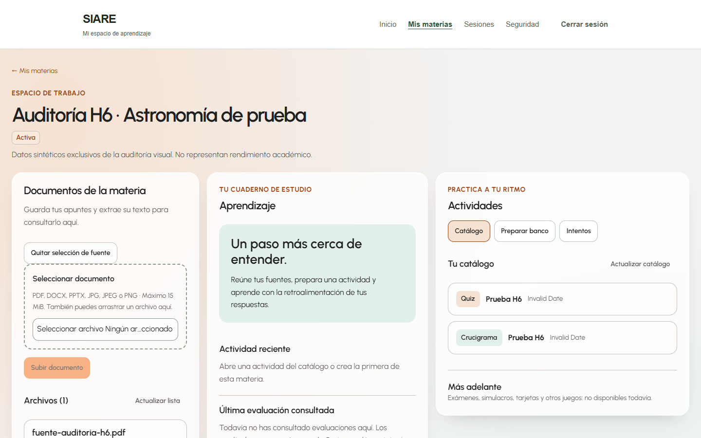

# H6-0: auditoría de SIARE Académico

Fecha: 19 de noviembre de 2026, America/Bogota. Estado: auditoría entregada para revisión. H6-1 y la implementación siguen pendientes de aprobación.

## Resultado

SIARE ya tiene un workspace H4 con Urbanist, acento naranja, fuentes READY, bancos revisados, Quiz y Crucigrama. H6 debe mejorar esa implementación y extender su identidad al resto de la aplicación. Los problemas principales son la pérdida de trabajo al cambiar de pestaña, la resolución de actividades en el lateral, el acceso tardío al aprendizaje en móvil y la coexistencia de dos lenguajes visuales.

Esta entrega incorpora documentación y capturas. No cambia código de aplicación, dependencias, contratos, migraciones ni configuración. No se construyeron imágenes ni se recrearon servicios. La excepción documental de `AGENTS.md` y la condición H6-0 del [plan original](H6_PLAN.md) permiten este cierre sin despliegue.

## Base comprobada

| Elemento | Referencia verificada |
| --- | --- |
| Rama H6 | `feat/h6-design-audit` |
| Worktree H6 | `.worktrees/h6`, aislado del checkout habitual |
| Base H6, main y origin/main tras fetch | `c8f934492f0cc7809282657270df34b4474915ca` |
| Checkout habitual | `fix/document-compatibility-isolation`, `acba2808ad0908ff05d6852cedb6eba5cb281171`, con cambios previos conservados |
| Fuente de frontend desplegado | `integration/h4-documents-deploy-20261119`, `697621ee8a6a450c551bbf6f13ffda6fc2beab18` |
| Diferencia H6 base frente a lo desplegado | `git diff 697621e -- frontend services`: sin diferencias |
| Proyecto Compose | `siare-academico`, nueve servicios healthy |
| Archivos Compose activos | `compose.datos.yml`, `compose.apps.yml` y `.local/deployment-h4-20261119/frontend-source.json` |
| Frontend activo | `siare-academico-frontend-1`, ID corto `eae9ae80e3c1` |
| Imagen activa de frontend | `siare-academico-frontend:0.1.0`, `sha256:c67d08bd4d4ef8e405f1d886ed3fec4c9fdb62f06be117184a8ff68c7c9ff5b0` |
| Acceso auditado | `http://127.0.0.1:3100`, salud HTTP 200 y `status: UP` |

El override activo compila una copia congelada del frontend H4. Reconstruir desde el checkout habitual antiguo haría retroceder la interfaz. Antes de implementar o desplegar H6 hay que exportar la revisión H6 aprobada y conservar los controles oficiales de propiedad y recursos.

La consulta de GitHub confirmó [PR #8](https://github.com/SttivGG/siare-academico/pull/8) abierto/draft, HEAD `ca27a80bf3d398286016ec871fa7cdc4fc64403f`, base main, y [PR #9](https://github.com/SttivGG/siare-academico/pull/9) abierto/draft, HEAD `ff104c2d4d6f6f7ebea7daeebdb36720620a1dca`, base H5-B. H6 no incorpora sus ramas ni Flyway V6. No se hicieron commits, push ni fusiones.

## Evidencias y método

Se revisaron los manifiestos, rutas, 16 módulos de componentes, políticas BFF, documentación de arquitectura y colaboración, el código Nexo original y sus capturas. El [inventario](H6_INVENTARIO.md) separa las pantallas completas de los estados internos del workspace. Las [referencias](H6_REFERENCIAS_NEXO.md) identifican archivos, valores y límites de reutilización.

Chromium `153.0.8010.12` se ejecutó sobre la instalación habitual mediante Playwright instalado en el proyecto. Se guardaron 34 capturas nuevas, medidas DOM de ocho resoluciones y siete referencias originales. Los resultados están en [evidencias/h6-0](evidencias/h6-0/README.md), [mediciones.json](evidencias/h6-0/mediciones.json) y [comprobaciones-adicionales.json](evidencias/h6-0/comprobaciones-adicionales.json). La versión efectiva del navegador consta también en el JSON.

La auditoría creó una cuenta `@example.test`, una materia explícitamente sintética, un PDF de la fixture existente y dos actividades de banco revisado exclusivo de prueba. La evaluación visible proviene de Spring y corresponde a esa cuenta. Esos registros permanecen aislados en la instancia; no representan rendimiento de estudiantes. Las credenciales temporales quedan fuera de los entregables, en la caché ignorada. No se modificaron cuentas, documentos o materias preexistentes.

## Problemas priorizados

P1 afecta la tarea de estudio o un requisito central de H6. P2 afecta consistencia, comprensión o eficiencia. No se atribuyen vulnerabilidades ni resultados WCAG completos a esta revisión visual.

| ID | Prioridad | Hallazgo y evidencia | Alcance de la corrección propuesta |
| --- | --- | --- | --- |
| UX-01 | P1 | Escribir el tema de un banco, pasar a Catálogo y volver a Preparar banco borra el borrador. Reproducido: `bankDraftSurvivesTabSwitch: false`. `activity-panel.tsx:69` monta condicionalmente el editor. | H6-3: conservar borrador, revisión y selección en un estado estable del workspace; cambiar panel no debe desmontar la sesión de edición. |
| UX-02 | P1 | Marcar una respuesta del Quiz, abrir Preparar banco y volver a Catálogo borra la respuesta. Reproducido: `quizAnswerSurvivesTabSwitch: false`. `activity-panel.tsx:70–77` desmonta el jugador y `activity-player.tsx` conserva respuestas en estado local. | H6-3: conservar respuestas, índice, celdas, duración y sobre idempotente. Añadir una prueba de transición de herramienta y tamaño con envío pendiente. |
| UX-03 | P1 | Quiz, Crucigrama, banco y resultado se resuelven dentro del lateral de Actividades. El centro muestra bienvenida, tarjetas y el formulario de materia abierto. [Quiz real](evidencias/h6-0/quiz-1440.png). | H6-3: el centro alberga la tarea seleccionada; el lateral ofrece accesos compactos. Mantener la evaluación autorizada y las cinco operaciones H3. |
| UX-04 | P1 | El centro mide 453 px frente a 521 px de Actividades a 1440 px. La regla es `.85fr 1fr 1.15fr`, `globals.css:180`. | H6-2/H6-3: centro dominante; dimensiones finales por prototipo y contenido, con aprobación expresa de tres paneles. |
| UX-05 | P1 | En 390 × 844 el aprendizaje empieza en y≈1311 y Actividades en y≈2851. En 320 px empieza en y≈1411 y y≈3035. Los enlaces saltan por una página larga; no hay un panel principal por vez. | H6-3: Fuentes, Aprendizaje y Estudio en navegación móvil accesible con estado compartido, sin arrastrar la barra lateral de escritorio. |
| UX-06 | P1 | El catálogo muestra `Invalid Date`. Su respuesta real contiene `activityId`, `subjectId`, `type`, `title`, `available`, sin `createdAt`; `activity-panel.tsx:74` intenta formatear ese campo. | H6-4: ajustar el tipo del resumen al contrato real y omitir datos no entregados. No inventar fecha ni añadir endpoint para decorar la tarjeta. |
| UX-07 | P1 | No hay tema oscuro en SIARE ni selector. Emular preferencia oscura mantiene texto y superficie: `systemDarkChangesWorkspace: false`. Nexo sí tiene tokens oscuros explícitos. | H6-1: definir ambos temas, estados y contrastes; aprobar antes de extenderlos. |
| UX-08 | P2 | Login, portada, inicio, materias, seguridad y sesiones mantienen Arial/verde; Urbanist y naranja están dentro de `.nexo-workspace`. La navegación superior conserva el estilo anterior incluso dentro de la materia. | H6-1/H6-2/H6-4: tokens y componentes compartidos, con migración por grupos de pantallas aprobados. |
| UX-09 | P2 | El encabezado ocupa ≈101 px en escritorio y ≈189 px en móvil. A 1440 px los paneles empiezan en y≈354; en móvil tras y≈548. | H6-2: navegación compacta, identidad y breadcrumbs sin repetir grandes títulos/contexto. Comprobar zoom y foco antes de fijar elementos. |
| UX-10 | P2 | La carga ocupa ≈236–259 px de forma permanente. El formulario de materia está abierto y la bienvenida/tarjetas desplazan el trabajo. | H6-3: carga bajo demanda y datos de materia contraídos; mostrar un estado central útil según selección. |
| UX-11 | P2 | Las fuentes tienen orden descendente por fecha, pero carecen de búsqueda y controles de plegado. El texto se consulta dentro de cada fila del lateral. | H6-3: búsqueda sobre datos disponibles, selección visible y texto en centro; preservar estados, cuarentena, C2PA y OCR. |
| UX-12 | P2 | Consultar intentos exige dos UUID. El historial mostrado solo reúne evaluaciones consultadas en esta sesión de pantalla. No existe listado histórico general H3. | H6-3/H6-4: facilitar enlaces y copia desde resultados reales. Mantener explícito el límite del backend; no presentar un historial inexistente. |
| UX-13 | P2 | Inicio anuncia que materiales y actividades llegarán después, aunque el workspace ya los ofrece (`inicio/page.tsx:10`). La portada aún expone información de fase/infraestructura. | H6-4: actualizar textos según capacidades entregadas; reservar información técnica para quien la necesite. |
| UX-14 | P2 | Las acciones de cerrar otras/todas las sesiones mutan inmediatamente; archivar y desconectar identidad sí tienen confirmación en línea. | H6-4/H6-5: revisar consecuencias y patrón de confirmación por acción, con cancelación verificable; SweetAlert2 queda en evaluación. |

## Adaptación medida

Medidas con una materia y un documento de prueba, fuente seleccionada y catálogo de dos actividades. Los títulos/contenidos reales pueden variar la altura.

| Viewport | Columnas efectivas | Ancho del centro | Inicio vertical de Aprendizaje | Inicio vertical de Actividades | Desbordamiento horizontal del documento |
| --- | --- | --- | --- | --- | --- |
| 1920 × 1080 | Tres | 573 px | 361 px | 361 px | No |
| 1440 × 900 | Tres | 453 px | 354 px | 354 px | No |
| 1366 × 768 | Tres | 429 px | 353 px | 353 px | No |
| 1024 × 768 | Dos; Actividades debajo | 480 px | 408 px | 1863 px | No |
| 768 × 1024 | Dos; Actividades debajo | 352 px | 405 px | 1983 px | No |
| 390 × 844 | Una; paneles apilados | 366 px | 1311 px | 2851 px | No |
| 375 × 812 | Una; paneles apilados | 351 px | 1334 px | 2899 px | No |
| 320 × 812 | Una; paneles apilados | 296 px | 1411 px | 3035 px | No |

La ausencia de desbordamiento no acredita una buena jerarquía: móvil sigue obligando a recorrer fuentes y edición antes de estudiar. La proporción central de NotebookLM es mayor que cada lateral; se usa como observación estructural, sin convertir la captura en medidas obligatorias.

## Accesibilidad, estado y contratos que se conservan

- El enlace de salto recibe foco con Tab y muestra contorno de 3 px. Se muestrearon 15 focos, con controles nativos y orden DOM; no se certifica el recorrido completo ni lector de pantalla.
- Hay etiquetas de campos, `aria-invalid`, errores junto al campo, avisos `status`/`alert`, selección de fuente con `aria-pressed` y progreso de carga. La selección de archivo mediante input ofrece alternativa al arrastre.
- La descarga estaba oculta en cuarentena y la fuente pudo seleccionarse tras READY. Se consultó texto sin `iframe`, `object` ni `embed`. Se abrió la confirmación de archivo y Cancelar mantuvo la materia activa.
- La reducción de movimiento se declara en CSS con `transition: none !important`. Las capturas se hicieron con `reducedMotion: reduce`; no se midieron todas las transiciones de estado y deberán comprobarse en H6-5.
- El cuerpo de SIARE usa 16 px; Nexo original usa 14 px. Reutilizar su identidad no obliga a reducir la legibilidad del texto académico.
- El ensayo con tamaño raíz al 200 % no produjo desbordamiento horizontal. Es ampliación de texto por CSS, **no zoom real de navegador al 200 %**; este último queda pendiente en H6-6.
- Cookies de sesión/renovación HttpOnly, BFF con CSRF y autorización de Spring se conservan. La idempotencia y la renovación serializada son restricciones de diseño, no controles decorativos.

Para contraste se calcularon pares opacos Nexo mediante luminancia relativa sRGB: tinta `#202020` sobre naranja `#f58136`, 6,27:1; blanco sobre ese naranja, 2,60:1. La [referencia de colores](H6_REFERENCIAS_NEXO.md) incluye otros pares. En superficies con transparencia hay que medir el fondo compuesto de cada tema; estos cálculos no certifican la aplicación completa.

## Límites de la auditoría

No se repitieron las suites históricas ni se atribuyen sus resultados a H6. No se ejecutaron build, TypeScript ni pruebas unitarias porque el cambio entregado es documental. Se revisaron sus comandos y cobertura para las siguientes fases.

Se probó Chromium real con escritorio redimensionado y medios emulados; no se simuló un teléfono físico ni su teclado virtual. Quedan pendientes Firefox/WebKit, zoom real, lector de pantalla, contraste compuesto exhaustivo, rendimiento y tamaño de JavaScript. El formulario administrativo autorizado y el alta/reemplazo MFA se inventariaron por código; no se elevaron roles ni se mostraron semillas o códigos en capturas. No se realizó login externo interactivo, recuperación SMTP, C2PA/OCR nuevos ni simulación de pérdida de red en esta fase.

Se consultaron [frontend-design](https://github.com/Hainrixz/claude-webkit/blob/main/.claude/skills/frontend-design/SKILL.md) y [Web Interface Guidelines](https://github.com/vercel-labs/web-interface-guidelines/blob/main/command.md) como apoyo para jerarquía, estado y revisión visual. La consulta de `building-components` no pudo recuperarse; no se atribuyen reglas a esa guía. La adaptación local documenta los límites.

### Modern Web Guidance

Consulté `responsive-design` y `css-layout` para evaluar distribución, tamaño intrínseco y scroll. Sus criterios se aplican al diagnóstico y a la propuesta pendiente; esta entrega no aplica cambios de código. Se usó la versión de skill local `2026_11_09-5bcc021b`; el buscador avisó de una versión posterior y no se actualizó la instalación global.

## Cierre de H6-0 y siguiente decisión

Los tres SKILL.md se leyeron íntegros; el [flujo SIARE](H6_SKILLS_SIARE.md) adapta DakaDesing sin tocar Ambrosia ni instalar dependencias. Las referencias Nexo y las tres capturas NotebookLM originales están identificadas y examinadas. El inventario, los problemas y las evidencias quedan disponibles para revisión.

El verificador oficial `powershell -NoProfile -ExecutionPolicy Bypass -File .\scripts\Test-Siare.ps1` terminó con código 0: nueve healthy, consultas de los cinco motores, Flask, Express, ClickHouse autenticado, puertos y comunicación frontend/Spring correctos. Los IDs e imágenes finales coinciden con [instalacion.json](evidencias/h6-0/instalacion.json), sin build, recreación ni reinicio. La comprobación no certifica logs globales libres de errores ni analítica de negocio.

Se comprobaron siete copias originales por SHA-256, enlaces relativos de los seis Markdown y la igualdad del plan guardado con el adjunto. Los dos archivos previamente modificados y las tres skills globales conservan sus hashes. El worktree H6 solo añade `docs/design/`, sin diferencias ejecutables respecto a su base; sus archivos quedan sin confirmar.

El siguiente entregable es H6-1: propuesta visual del sistema de diseño, catálogo y estados en claro/oscuro, todavía sin aplicación masiva. Aprobar esta auditoría permite preparar esa propuesta; no equivale a aprobar el shell H6-2, los tres paneles H6-3 o las pantallas posteriores. La aprobación expresa de distribución exigida en H6-3 sigue pendiente.
