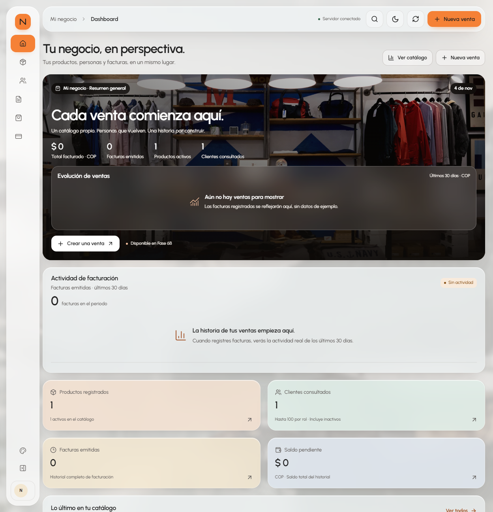
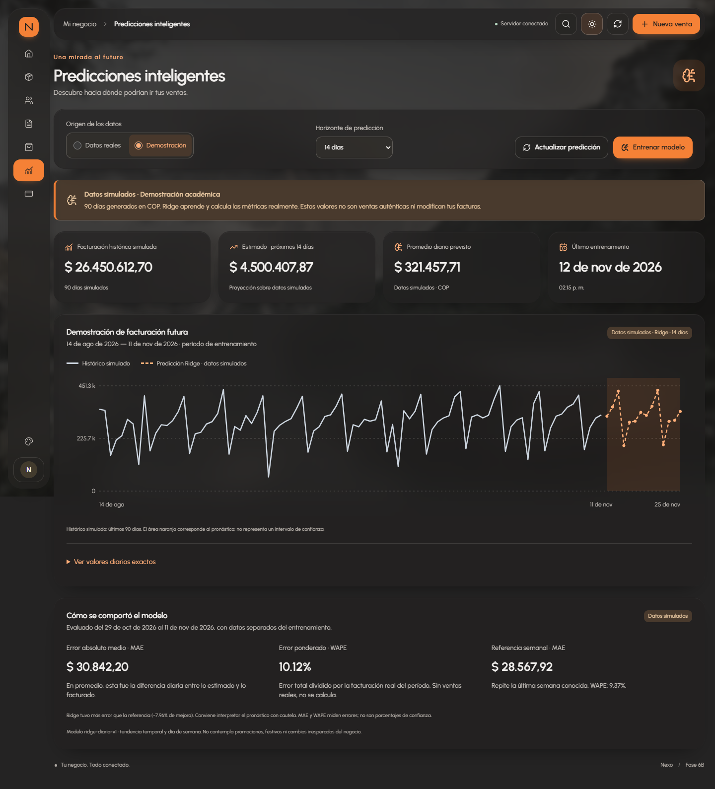
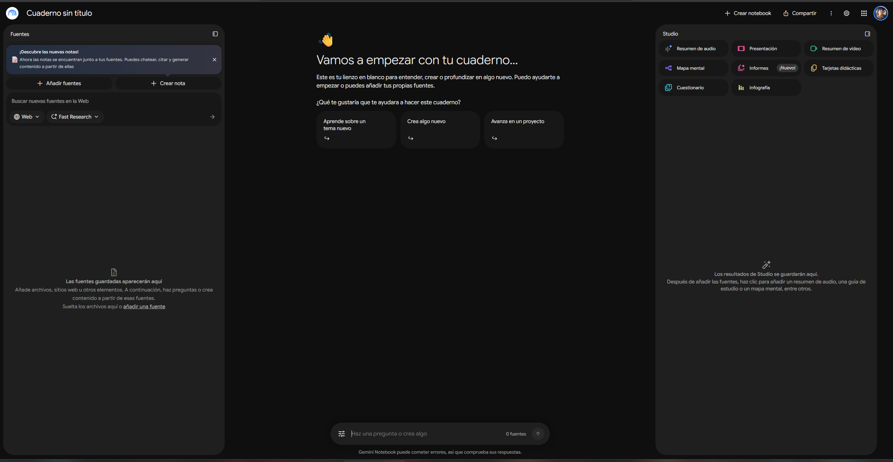

# H6-0: referencias verificadas de Nexo y NotebookLM

La identidad elegida por el usuario es Nexo, del proyecto Facturación Hexagonal. NotebookLM aporta organización espacial y acceso al material. La referencia está resuelta por el [plan H6](H6_PLAN.md); no se requiere volver a elegir Steep.

Los valores siguientes describen la fuente existente. Su traducción a tokens semánticos SIARE, las correcciones de contraste y los prototipos pertenecen a H6-1 y requieren aprobación. Esta auditoría no aprueba un nuevo sistema de diseño.

## Procedencia

| Material | Fuente examinada | Uso y límite |
| --- | --- | --- |
| Proyecto Nexo | `D:/ITP/Septimo Semestre/Programación Avanzada/corte3/facturacion-hexagonal` | Lectura de CSS, componentes UI, apariencia y manifiesto. HEAD `8a3ea0f52eb6010322ec1b95751a593132673916`; el proyecto tiene cambios locales, por eso se registran hashes de archivos concretos y no se atribuye todo el árbol a ese commit. |
| Tokens y fuente | `frontend/src/styles/tokens.css`; `frontend/public/fonts/urbanist-latin.woff2` y `OFL-Urbanist.txt` | Fuente primaria de valores. SIARE H4 ya contiene Urbanist local y licencia. |
| Layout y comportamiento | `styles/layout.css`, `styles/responsive.css`, `styles/components.css`, `components/ui.tsx`, `appearance.tsx` | Barra, encabezado, formularios, temas y overlays. No se copian lógica de facturación ni hooks de negocio. |
| Capturas Nexo | `docs/capturas/fase6a1/nexo-despues.png`, `nexo-formulario.png`, `nexo-movil.png`; `docs/capturas/fase8b/demo-dark-desktop.png` | Copias originales conservadas en evidencias. La captura oscura de fase6a1 muestra un velo/transición y no se toma como referencia fiable de contraste. |
| Diagramas Nexo ML | `../imagenesNexoML/NexoML_1.png` y `NexoML_2.png` | Examinados como contexto; son láminas explicativas, no capturas del sistema visual ni fuente de tokens. |
| NotebookLM | `C:/Users/Daniel Giraldo/Pictures/Screenshots/NBML`, ruta aportada por el usuario | Tres capturas originales de cuaderno vacío oscuro, encabezado, Fuentes y Studio. No muestran una sesión con fuentes cargadas, móvil ni interacción de herramientas. |

Las rutas originales y SHA-256 de archivos y capturas constan en [referencias-origen.json](evidencias/h6-0/referencias-origen.json). Las copias están disponibles dentro del repositorio para revisión sin depender de carpetas personales.

## Colores existentes de Nexo

| Función original | Claro | Oscuro |
| --- | --- | --- |
| Texto principal | `--text: #202020` | `#f1efed` |
| Texto secundario | `--muted: #625e5c` | `#c4bfba` |
| Texto tenue | `--faint: #706c6a` | `#b3ada7` |
| Acento / hover | `--accent: #f58136`; `--accent-hover: #ff954f` | Se conservan |
| Tinta sobre acento | `--accent-ink: #202020` | Se conserva |
| Acento para texto | `--accent-text: #9c4312` | `#ffae78` |
| Foco | `--focus: #a44714` | `#ffa86e` |
| Fondo neutral | `--neutral: #f4f4f4` | `#242323` |
| Superficie sólida | `--surface-solid: #f6f6f5` | `#292725` |
| Superficie elevada | `--surface-raised: #eae8e5` | `#35312e` |
| Superficie translúcida | RGB `242,246,248`, opacidad predeterminada `.68` | RGB `34,33,32`, misma opacidad predeterminada |
| Input | `rgba(255,255,255,.66)` | `rgba(49,46,43,.82)` |
| Borde / borde fuerte | `rgba(66,48,37,.10/.20)` | `rgba(255,246,238,.12/.22)` |
| Hover / activo | `rgba(72,55,43,.045)` / `rgba(245,129,54,.12)` | Hover `rgba(255,242,230,.06)`; activo conserva acento |
| Rosa cálido | `--rose: #f6e2d2` | `#48372e` |
| Menta | `--mint: #e1f0ea` | `#303e37` |
| Crema | `--cream: #f3e7d1` | `#423b2d` |
| Azul pastel | `--blue-pastel: #e3eaf2` | `#363b43` |
| Éxito / superficie | `--green: #326448` / `#e5eee8` | `#b8d9c2` / `#34483b` |
| Información / superficie | `--blue: #4d5c70` / `#e8edf2` | `#ccd5df` / `#363e47` |
| Advertencia / superficie | `--amber: #895014` / `#f8eadb` | `#e3c39d` / `#493a2d` |
| Error / superficie | `--danger: #9f3434` / `rgba(159,52,52,.08)` | `#f1aaaa` / `rgba(220,120,120,.10)` |

El naranja sirve como acento y fondo de acciones con tinta oscura. El color para enlaces/etiquetas es otro token. No intercambiarlos sin medir contraste.

| Par opaco de referencia | Contraste sRGB calculado | Interpretación para texto normal |
| --- | --- | --- |
| `#202020` sobre `#f58136` | 6,27:1 | Supera 4,5:1 |
| `#ffffff` sobre `#f58136` | 2,60:1 | No alcanza 4,5:1; evitar texto blanco en acción naranja |
| `#9c4312` sobre `#f6f6f5` | 6,02:1 | Supera 4,5:1 |
| `#625e5c` sobre `#f6f6f5` | 5,93:1 | Supera 4,5:1 |
| `#f1efed` sobre `#292725` | 12,97:1 | Supera 4,5:1 |
| `#c4bfba` sobre `#292725` | 8,16:1 | Supera 4,5:1 |
| `#ffae78` sobre `#292725` | 8,20:1 | Supera 4,5:1 |

Se utilizó luminancia relativa sRGB linealizada y `(Lmayor + .05)/(Lmenor + .05)`. Estos son pares de referencia sin alpha. H6-1 debe repetir mediciones con superficies/fondos compuestos, límites de controles, foco, selección y cada tema.

## Tipografía, composición y detalles

Urbanist se sirve desde un WOFF2 local con pesos 400–700 y `font-display: swap`, seguido de `system-ui, sans-serif`. La fuente tiene licencia SIL OFL 1.1, atribuida a Urbanist Project Authors. Se debe conservar la licencia al distribuirla. La composición no exige descargar otra fuente ni llamar a Google Fonts.

Nexo usa cuerpo de 14 px, interlineado 1,5 y peso 500. Sus títulos principales están alrededor de 32–33 px, peso 600 y espaciado negativo; etiquetas y metadatos bajan a 10–13 px. Para lectura académica, la propuesta SIARE debe conservar una base legible de 16 px y revisar metadatos pequeños al 200 %. Es una adaptación de usabilidad propuesta, todavía sin implementación.

Las superficies emplean radio 22 px, controles de 12–14 px, borde translúcido, luz interior y sombra exterior discreta. La sombra clara combina `inset 0 1px 0 rgba(255,255,255,.85)`, una sombra de 1–2 px muy tenue y una sombra de 18–40 px con spread negativo. El desenfoque predeterminado es 26 px. El CSS ofrece superficie sólida cuando no se admite `backdrop-filter`; esa legibilidad debe preservarse en SIARE.

Nexo tiene una barra de iconos flotante de 84 px, con separación estructural de 108 px, situada a 16 px de los bordes. El encabezado flotante mide 64 px y agrupa breadcrumbs y acciones. La página limita el ancho a 1720 px. En móvil el original conserva una barra de 72 px y reserva 88 px. **El plan SIARE exige adaptar la navegación móvil**; esa decisión prevalece sobre copiar literalmente la barra Nexo.

La captura histórica `nexo-movil-original.png` muestra un menú superior, mientras el CSS actual inspeccionado declara la barra persistente. Son evidencias de versiones distintas. Para valores se utiliza el código identificado por hash; para composición visual se conserva la captura con su procedencia, sin atribuirle el comportamiento del CSS actual.

La iconografía procede de `lucide-react`, con trazos de SVG y tamaños cercanos a 18–20 px en navegación. SIARE aún no declara esa dependencia. H6-1 debe elegir una forma coherente de reutilizar iconos, con nombres accesibles y licencia verificable; esta auditoría no instala la librería.

Los formularios Nexo agrupan campos por tarea; inputs tienen altura mínima de 44 px y etiquetas visibles. El componente `Overlay` usa `<dialog>`, `showModal()`, portal, título por `useId`, tratamiento de Escape y bloqueo de cierre cuando está ocupado. `Confirm` se construye sobre ese overlay. Esta evidencia permite evaluar alternativas nativas antes de añadir SweetAlert2.

Las transiciones de Nexo usan 220 ms y `cubic-bezier(.2,.7,.2,1)` para color, borde y sombra; navegación/entrada tienen animaciones discretas. Existen variantes de reducción de movimiento y cierres de overlay sin demora cuando está activa. Son referencias de ritmo, no una obligación de animar cada tarjeta. No se heredan fotografías de ventas, métricas financieras ni demostraciones de ML.

La segunda captura contiene datos simulados de la demostración financiera original. Solo documenta el tema oscuro; no constituye una fuente de métricas SIARE.

## Organización observada en NotebookLM

Las tres capturas muestran un encabezado corto, una columna izquierda de Fuentes, una zona central amplia y una columna derecha Studio. Las superficies laterales delimitan recursos y herramientas; el centro da contexto al cuaderno y deja espacio a la tarea. El acceso a añadir fuentes es compacto y explícito. Los controles superiores de los laterales sugieren plegado, pero la captura no demuestra su comportamiento.

En `notebooklm-original-1.png`, a 2556 × 1325, cada lateral ocupa aproximadamente una cuarta parte del ancho y la zona central cerca de la mitad. Son medidas visuales aproximadas, no geometría DOM ni una norma para SIARE. En el workspace H4, la proporción actual `.85/1/1.15` favorece el lateral derecho y el jugador permanece allí; ésa es la diferencia organizativa que H6-3 debe resolver.

La traducción funcional propuesta es Fuentes para documentos existentes, Aprendizaje para lectura/resolución/evaluación y Estudio para elegir Quiz, Crucigrama, catálogo, banco e intento. No se copian chat, búsqueda web, Fast Research, audio, mapas mentales, presentaciones, infografías o tarjetas como si estuvieran disponibles. Las capturas no prueban la adaptación móvil de NotebookLM; el comportamiento móvil de SIARE deberá diseñarse y aprobarse por separado.

## Decisiones pendientes para H6-1

Definir el vocabulario semántico SIARE para ambos temas, la escala tipográfica académica y densidad, el nivel de transparencia permitido y el catálogo de estados. Después, mostrar prototipos claros/oscuros sin integrarlos en las pantallas productivas. La identidad Nexo ya está elegida; los valores ajustados, los componentes y la distribución final aún requieren revisión.
