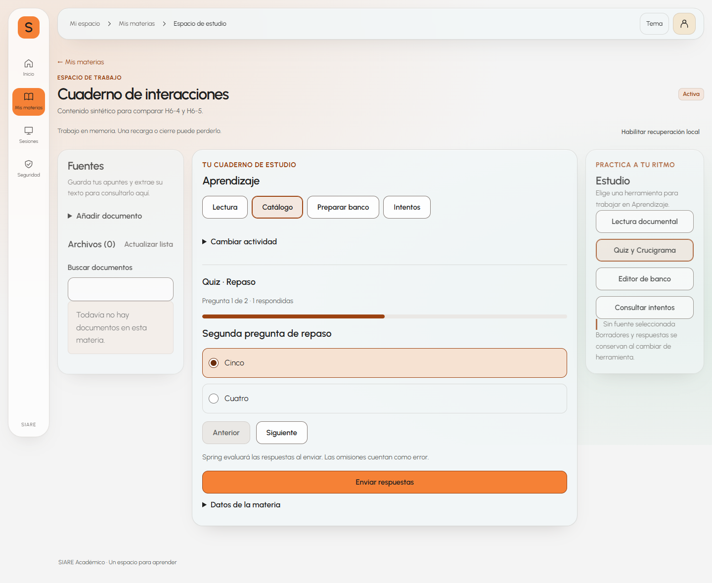
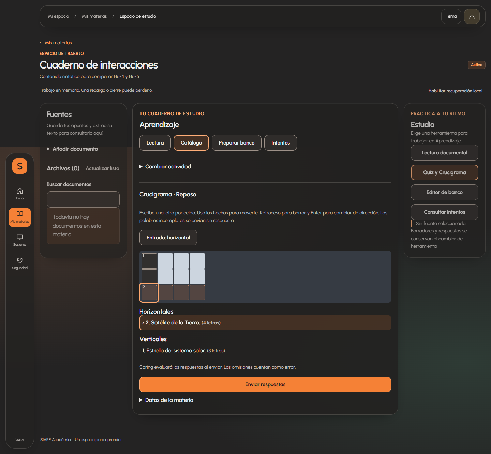
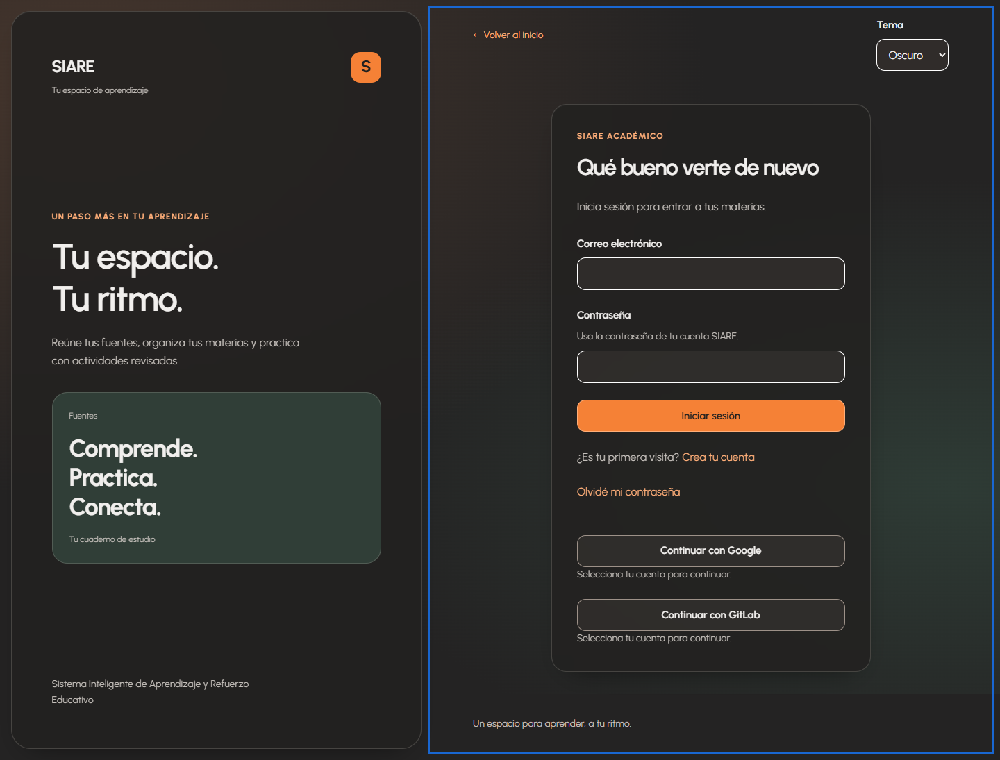

# Evidencia H6-5

Preview real en `http://127.0.0.1:3107`, runtime `06000f6ec47fc0bfe467de05456c5e25ca9cce76`. [Informe](../../H6_5_INFORME.md), [comparación antes/después](../../H6_5_COMPARACION.md), [rendimiento](../../H6_5_RENDIMIENTO.md) y [matriz de 50 casos](../../H6_MATRIZ_ACEPTACION.csv).

Se seleccionaron 58 PNG: 24 antes, 24 después, seis de administración controlada, dos del diálogo de recuperación y una de forced colors/movimiento reducido; la restante documenta el navegador habitual en 3100. Los campos de contraseña de las comparativas tienen una máscara de privacidad magenta; ese rectángulo no es un color de la interfaz. El diálogo de recuperación contiene la frase vacía. Las capturas no incluyen semillas, QR, códigos MFA, tokens ni documentos privados.

| Registro | Contenido y límite |
| --- | --- |
| [pruebas.json](pruebas.json) | Resultado por prueba de Playwright final, unitarias/componentes, build, TypeScript e integraciones. Tres duplicaciones móviles históricas; ninguna omisión nueva. |
| [rendimiento.json](rendimiento.json) | 36 navegaciones, medianas, tamaños reales JS/CSS/gzip y observación CDP/DOM en reposo. Sin atribución causal ni certificación de Core Web Vitals. |
| [runtime.json](runtime.json) | Rama, base, revisión del runtime, imágenes, contenedores, salud, rollback y preservación de los nueve habituales. No contiene variables de entorno ni claves. |
| [conservacion.json](conservacion.json) | Doce archivos críticos, BFF, servicios y Compose idénticos a la base. |
| [habitual-browser.json](habitual-browser.json) | Portada y login de 3100 en navegador y salud UP. |
| [contraste.json](contraste.json) | Pares de tokens calculados en Chromium sobre fondos compuestos. No es auditoría WCAG completa de píxeles. |
| [capturas.json](capturas.json) | Archivo, tema y procedencia de cada captura seleccionada. |
| [manifest.sha256](manifest.sha256) | Integridad de los archivos publicados en este directorio. |

La carpeta `controlled/` procede de Next de producción con un upstream HTTP local grabador. No prueba permisos ADMIN/SUPERADMIN reales. `before/` y `after/` usan Spring y una cuenta USER sintética propia. La regresión documental adicional C2PA usa un original autorizado en la caché privada; ese PDF no se publica.

El recorrido académico verifica ambos temas y 1920×1080, 1440×900, 1366×768, 1024×768, 768×1024, 390×844, 375×812 y 320×812. El full-page puede tener más altura que el viewport original; las barras fixed se sitúan respecto a ese viewport. Las comprobaciones de teclado y continuidad están en las pruebas, no se deducen de las imágenes.

Firefox/WebKit, lector de pantalla, dispositivos físicos, teclado virtual y zoom real 200 % siguen pendientes. Ver los demás pendientes exactos H6-6 en el informe. Las capturas generadas por la regresión completa se conservan en la caché local; se publica esta selección para evitar duplicar las galerías históricas.

